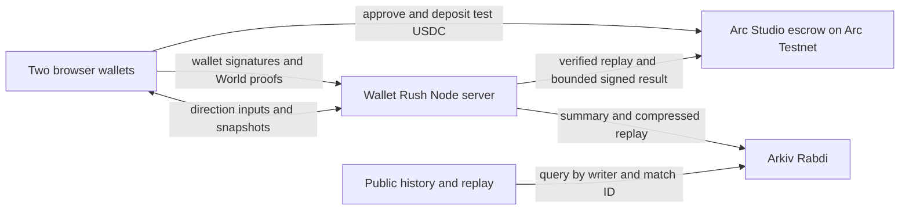

# Wallet Rush sponsor setup

## Track checklist

- **World — Best Use of IDKit.** Demo the Proof of Human prize-entry flow and a denied or canceled attempt. Explain why unique-human eligibility is needed, and include the integration debrief. [World prize](https://ethglobal.com/events/mumbai/prizes/world)
- **Arkiv — Build on Arkiv (from scratch).** Confirm the team is in the Classic track and that project-specific work began after kickoff. Submit the public repository with an open-source license approved by the rights holder, disclose AI use, add the actual writer address and runnable query, and demo both a real Rabdi write and an application read. [Arkiv prize](https://ethglobal.com/events/mumbai/prizes/arkiv) · [ETHGlobal rules](https://ethglobal.com/rules)
- **Arc — Best Smart Contracts with Advanced Stablecoin Logic, In Arc Studio.** Create, test, deploy and connect the escrow inside Studio. Include a shareable project URL, GitHub repo, working frontend/backend, architecture diagram and a video showing Studio. [Arc prize](https://ethglobal.com/events/mumbai/prizes/arc)

## 1. Start the escrow inside Arc Studio

The current Wallet Rush escrow is already deployed and verified. For this demo, use the [deployment record](arc-deployment.md) and continue to section 2. The steps below reproduce the Studio workflow for a fresh deployment.

Start here before hosting Wallet Rush. The link Arc judges need is the **shareable Arc Studio project URL**. A hosted game link, the GitHub repository, and the ArcScan receipt are separate links.

1. Open [Arc Studio](https://studio.arc.io/). Click **Sign in** or **Sign up**, then use **Start on the web** to open the workspace if the landing page is still visible.
2. Start a project with **Write a contract**, the current label on Studio's public homepage. If your signed-in workspace offers **Smart Contract** and **Build** modes, choose **Smart Contract** to start. The bounty requirement concerns what you build and test inside Studio.
3. Paste the full [Wallet Rush escrow prompt](arc-studio-prompt.md) into the prompt box and submit. Name the project **Wallet Rush Escrow**. Review the generated plan for the escrow contract, tests, and a connected demo page. Keep deployment pending.
4. Open the workspace's file explorer and **Contracts** panel to inspect the generated contract. Ask Studio to compile and run the full test suite. The test output should cover winner payout, draw and cancellation refunds, timeouts, duplicate deposits, unauthorized signatures, and double settlement. Save the test output.
5. Use the workspace's code export option to save the Solidity source, tests, ABI or build artifact, and generated demo page. Copy the project share URL if sharing is available at this stage. Share the export and public URL for review. Keep private keys out of the export and chat.
6. After review, use the **Contracts** panel or the Studio deployment workflow. Select **Arc Testnet**, chain ID `5042002`, and supply the referee's **public wallet address** as the constructor argument. Review the network before approving. Save the contract address and successful deployment transaction in [the deployment record](arc-deployment.md).
7. Stay in the same Studio project. If the frontend was not generated in contract mode, ask Studio to build a small escrow page around the deployed testnet address. Use the live preview to connect a test wallet and demonstrate a real onchain read or interaction with the deployed escrow. Save the project share URL and try it in a private window. If the share or export control is unclear, check the workspace menu or share a screenshot of that screen with sensitive fields hidden.

The public homepage and walkthrough confirm the entry point, **Contracts** panel, compilation, tests, live preview, testnet deployment and code export. Signed-in menu labels can vary. [Arc Studio homepage](https://studio.arc.io/) · [Arc Studio walkthrough](https://www.arc.io/blog/build-a-usdc-revenue-splitting-app-with-arc-studio-no-code-required) · [Arc bounty](https://ethglobal.com/events/mumbai/prizes/arc)

## 2. Set up the local environment

In PowerShell, from the repository folder:

```powershell
git fetch origin
git switch codex/web3-sponsors
git pull --ff-only
npm ci
if (!(Test-Path .env)) { Copy-Item .env.example .env }
notepad .env
```

Fill in the local, ignored `.env`. Share only public wallet addresses, public links, and transaction hashes. Signing keys and wallet recovery phrases stay private. Values starting with `VITE_` are visible to browsers.

### World ID

1. On the [World Developer Portal](https://developer.world.org/), click **Go to console** or **Sign in**. In the console create a Wallet Rush app and open that app's World ID settings. If it is an older app, complete **Enable World ID 4.0**.
2. Copy the app ID into `WORLD_APP_ID`, RP ID into `WORLD_RP_ID`, and RP signing key into `WORLD_RP_SIGNING_KEY`. Use credentials for the environment you intend to test.
3. Leave `WORLD_ACTION=wallet-rush-mumbai-2026` for the first tournament and use the same value for both players. Set `WORLD_ENVIRONMENT=staging` for the official simulator. When IDKit displays the verification request, open or scan it with the [World ID Simulator](https://simulator.worldcoin.org/) or the sandbox app linked in the event's World resources. Use two separate test identities. Simulator proofs are for staging. [World ID setup](https://docs.world.org/world-id/idkit/integrate) · [Mumbai World resources](https://ethglobal.com/events/mumbai/prizes/world)

### Arc Testnet wallets

1. Create two dedicated player wallets in separate browser profiles. Create a separate referee test wallet. Copy their **public addresses**. Keep the player keys inside their wallets.
2. On the [Circle faucet](https://faucet.circle.com/), select **USDC**, select **Arc Testnet** under **Network**, paste a public address under **Send to**, then click **Send 20 USDC**. Complete any CAPTCHA. Repeat for both players and the referee within the faucet's limits. Players need at least 10 test USDC each plus gas. The referee needs test USDC for gas. The Studio workspace also offers a **Testnet Faucet** for its preview wallet.
3. Put the referee test wallet's signing key in `ARC_REFEREE_KEY` on the host. Its public address must match the immutable referee in the deployment record. For the reviewed deployment set `ARC_ESCROW_ADDRESS=0xCd8BD94B8f6C79E82F0e63Fa3743bf70d5cc2623` and set `ARC_STUDIO_PROJECT_URL` to the Studio project URL. The app's **Switch to Arc Testnet** control adds the network if needed. The network uses [Arc Testnet Explorer](https://explorer.testnet.arc.io/). [Circle faucet](https://faucet.circle.com/) · [Arc Testnet chain details](https://docs-w3s-node-sdk.circle.com/variables/index.ARC_TESTNET.html)

### Arkiv Rabdi writer

1. Use a separate test wallet for the archive. Open [Arkiv Hub → Faucet](https://hub.arkiv.network/faucet), connect that wallet, select Rabdi if prompted, and claim tGLM under **Get tGLM**. Check that the writer address received testnet gas before running the demo.
2. Set `ARKIV_WRITER_KEY` to the test writer's private key on the host. Set `VITE_ARKIV_WRITER_ADDRESS` to the same wallet's **public address**. They must refer to the same account.
3. The public RPC can be used for an initial read. If it rate-limits your demo, open [Arkiv Hub → Access Keys](https://hub.arkiv.network/access-keys). Set the server key in `ARKIV_ACCESS_KEY` and an origin-restricted browser key in `VITE_ARKIV_ACCESS_KEY`. The browser key is public. Use the actual browser origin you will open, including the port for local testing if the key settings require it. [Rabdi connection docs](https://docs.arkiv.network/start-here/clients/)

## 3. Run and record the funded demo

1. Run `npm run dev` and open the URL it prints in two separate wallet profiles. Use the same origin in both. On one machine use `http://localhost:5173` if Vite selected that port. Use an HTTPS game URL if running the sponsor demo from different devices over the internet.
2. In each profile click **Prize match → Connect wallet → Switch to Arc Testnet** as needed. Check the address, network and test USDC balance. If the page says **Prize rooms await sponsor setup**, check the variables above and restart the server after editing `.env`.
3. Click **Verify prize eligibility**. Approve the wallet ownership message, then complete the World IDKit request. Show one canceled or rejected request first, followed by success. Use a third test wallet with the first test identity to demonstrate duplicate rejection if the staging app permits issuing another proof.
4. In the prize lobby click **Create match** in the first profile. Share the invite or code. Join in the second profile and click **Confirm prize entry** in both. Wait for **Arc escrow receipt**.
5. In each profile click **Deposit 10 test USDC**. The wallet may show an allowance approval first and a deposit transaction second. Confirm both on Arc Testnet. Wait for **Arc deposit receipt**, then click **Ready after deposit** in both profiles. Play until the result is verified. For a quick bank, move down from spawn into the vault.
6. Open **Arc settlement receipt** after the match. Confirm the transaction succeeded and paid the winner or returned the deposits for a draw or eligible cancellation. Open **Arkiv archive receipt**, then **Public Arkiv replay**. From a fresh browser session without a wallet, open **Match history**, select the same match, and scrub both players' replays.
7. Record the Studio project URL, GitHub repository, verified contract and deployment receipt, two deposit receipts, settlement or refund receipt, Arkiv writer address and archive receipt, and replay URL. Show Studio, the funded match, and the public replay in the demo video. To exercise timeout recovery separately, use a fresh staging tournament scope and match. After the applicable deadline, open **Prize match → Recover test USDC from an expired match**, enter the prize match code and click **Request timeout refund**.

If Arc finalizes a settlement or timeout while a USDC transfer is deferred, the app labels the deferral separately. Connect the recipient account and use **Claim deferred test USDC** when the token permits transfers. A settlement receipt alone does not prove that a deferred transfer reached the wallet.

## 4. Host the game only if a public game URL is needed

A standard Vercel or Netlify static deployment can serve the frontend build, but it will not run Wallet Rush's existing Node process, shared in-memory match rooms, `/ws`, or `/api/prize`. The current app expects all of those at the same origin. Vercel also documents a Functions WebSocket option with instance and duration limits, which would need a different server integration and shared state. For this demo, run locally first. [Netlify Vite hosting](https://docs.netlify.com/build/frameworks/framework-setup-guides/vite/) · [Vercel WebSocket architecture](https://vercel.com/kb/guide/real-time-chat-websockets)

For a public hackathon demo without changing the app architecture, one option is a single HTTPS Node web service:

1. In the Render dashboard, choose **New → Web Service → Git Provider** and select the Wallet Rush repository and `codex/web3-sponsors`. Select a supported Node LTS release and keep one service instance.
2. Set **Build Command** to `npm ci --include=dev && npm run build` and **Start Command** to `npm run preview -- --host 0.0.0.0 --port "$PORT" --strictPort`. This reuses the app's existing preview server for a temporary demo.
3. Under **Environment** set the sponsor variables and `WALLET_RUSH_ORIGIN` to the exact public HTTPS origin, without a trailing slash. Set the `VITE_` values before building. Preserve the two ledgers on persistent storage before running funded matches. For a disk mounted at `/var/data`, use `WORLD_ELIGIBILITY_FILE=/var/data/world-eligibility.json` and `PRIZE_ENTRY_FILE=/var/data/prize-entries.jsonl`. Render's persistent disks require a paid service.
4. Open the deployed URL in two sessions. Confirm practice, a casual duel, and the History screen work before entering test funds. Share this game URL separately from the required Studio project link.

[Render Web Services setup](https://render.com/docs/web-services) · [Render WebSockets](https://render.com/docs/websocket) · [Render persistent disks](https://render.com/docs/disks)

## Architecture



The server decides the winner after independently replaying both simulations. The escrow trusts the configured referee's signature and enforces the contract's funding, deadline and finalization rules. Run one server process and preserve the local registration and entry ledgers. A crash during gameplay can end the live room. The deployed escrow must allow a permissionless timeout refund even if the server is unavailable. Review the Studio export before enabling deposits.

## Evidence to fill after the demo

The [Arc deployment record](arc-deployment.md) includes the confirmed contract and deployment transaction. Judge access to the Studio project URL, player deposits and settlement, first live World verification and an Arkiv write remain to be demonstrated.
