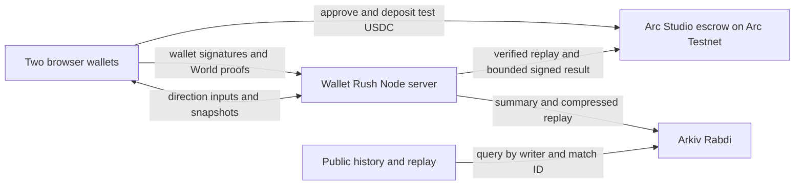

# Wallet Rush sponsor setup

## Track checklist

- **World — Best Use of IDKit.** Demo the Proof of Human prize-entry flow and a denied or canceled attempt. Explain why unique-human eligibility is needed, and include the integration debrief. [World prize](https://ethglobal.com/events/mumbai/prizes/world)
- **Arkiv — Build on Arkiv (from scratch).** Confirm the team is in the Classic track and that project-specific work began after kickoff. Submit the public repository with an open-source license approved by the rights holder, disclose AI use, add the actual writer address and runnable query, and demo both a real Rabdi write and an application read. [Arkiv prize](https://ethglobal.com/events/mumbai/prizes/arkiv) · [ETHGlobal rules](https://ethglobal.com/rules)
- **Arc — Best Smart Contracts with Advanced Stablecoin Logic, In Arc Studio.** Create, test, deploy and connect the escrow inside Studio. Include a shareable project URL, GitHub repo, working frontend/backend, architecture diagram and a video showing Studio. [Arc prize](https://ethglobal.com/events/mumbai/prizes/arc)

## 1. Configure World ID

From the repository in PowerShell, run `if (!(Test-Path .env)) { Copy-Item .env.example .env }`. Edit the local `.env` with your test credentials.

1. Sign in to the [World Developer Portal](https://developer.world.org/) and create a Wallet Rush app with World ID 4.0 enabled.
2. Copy the app ID, RP ID and RP signing key into your local, ignored `.env` using the names in `.env.example`. Keep the signing key private.
3. Choose one tournament action, such as `wallet-rush-mumbai-2026`. Use the same action for all participants. Keep `WORLD_ENVIRONMENT=staging` for the [official simulator](https://simulator.worldcoin.org/). Use separate simulator identities for the two players and reuse one identity with another wallet to demo the duplicate rejection. [World setup](https://docs.world.org/world-id/idkit/integrate)

## 2. Fund the test wallets

1. Create two dedicated player wallets in separate browser profiles. Add Arc Testnet using the app's **Switch to Arc Testnet** button. The chain ID is `5042002` and the RPC is `https://rpc.testnet.arc.network`.
2. Fund each player with at least 10 test USDC plus gas using the [Circle faucet](https://faucet.circle.com/). Use a third dedicated Arc Testnet wallet as the referee and fund it for gas. Store the referee's private key only in the host's `.env` as `ARC_REFEREE_KEY`. Keep player private keys inside their wallets.
3. Fund a separate Arkiv writer address with Rabdi tGLM via the [Arkiv faucet](https://hub.arkiv.network/faucet). Put only that test writer's private key in `ARKIV_WRITER_KEY`. Set `VITE_ARKIV_WRITER_ADDRESS` to its public address. Optional [access keys](https://hub.arkiv.network/access-keys) can be restricted to the server IP and the browser origin. The browser key is public.

## 3. Complete Arc Studio

1. In [Arc Studio](https://studio.arc.io), start in **Smart Contract mode** and paste the [escrow brief](arc-studio-prompt.md).
2. Export the generated source, tests and ABI for review. Compare them with the brief before deploying. Supply the referee's **public address** as the constructor argument, then deploy on Arc Testnet and connect a demo page in Studio.
3. Keep the Studio share link, deployment transaction, contract address, verified source and Studio test results. Set `ARC_STUDIO_PROJECT_URL` and `ARC_ESCROW_ADDRESS` in the local `.env`. The production prize control requires valid World, escrow and archive configuration.

## 4. Record the real demo

1. Run `npm ci` and `npm run dev`. For the sponsor demo, use `localhost` in two separate wallet profiles or an HTTPS origin shared by both devices. Casual matches also work over a trusted LAN IP.
2. Click **Prize match**, connect each wallet, switch to Arc Testnet, and sign the wallet ownership message. Complete World ID. Use **Create match** on one profile and the invite on the other.
3. Both players click **Confirm prize entry**. Wait for the escrow receipt, then each approves and deposits 10 test USDC. Ready up after both deposits. Play, bank, and finish the match.
4. Open the confirmed settlement receipt in ArcScan. Open **Match history** and the public replay in a browser session without a wallet. Save both deposit receipts, the settlement receipt, the Arkiv transaction and entity key, and the public replay URL for the submission.
5. To test a timeout refund, use a separate test tournament action and prize match. After the deadline, use **Recover test USDC from an expired match** with the prize match code and check the Arc receipt.

## Architecture

The server decides the winner after independently replaying both simulations. The escrow trusts the configured referee's signature and enforces the contract's funding, deadline and finalization rules. Run one server process and preserve the local registration and entry ledgers. A crash during gameplay can end the live room. The deployed escrow must allow a permissionless timeout refund even if the server is unavailable. Review the Studio export before enabling deposits.

## Evidence to fill after the demo

The Studio project URL, Arc deployment and transactions, first live World verification and Arkiv write are pending the steps above. Keep only confirmed transaction IDs in the submission.
